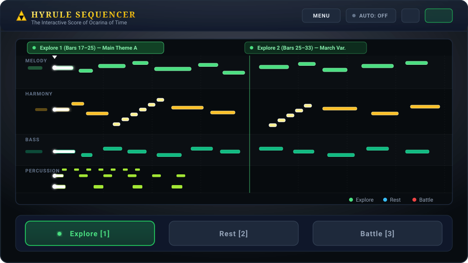
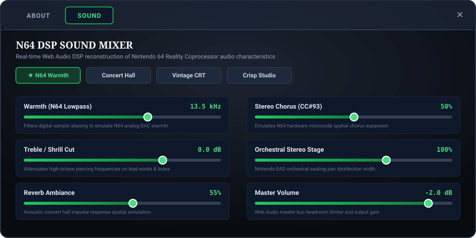
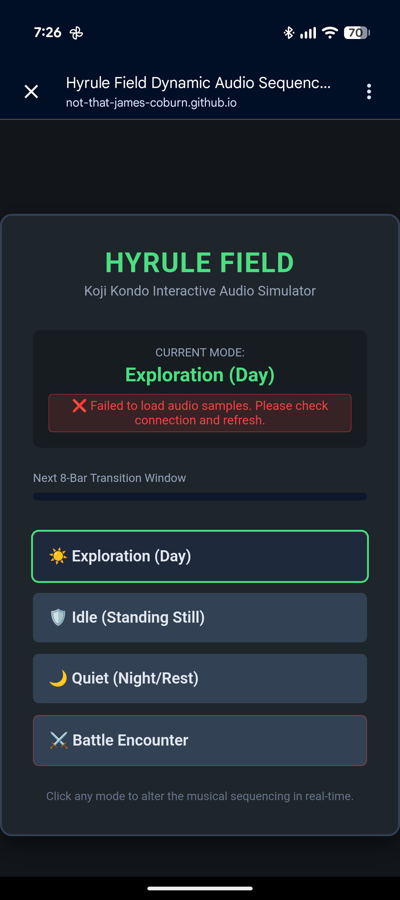
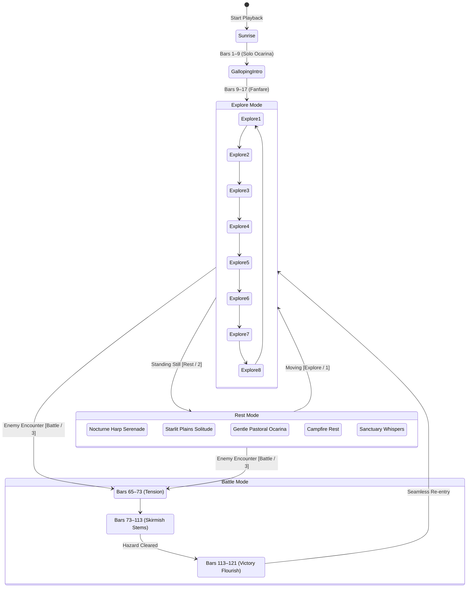
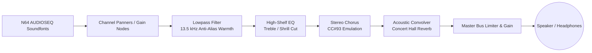

# Hyrule Sequencer

> **The Interactive Score of *The Legend of Zelda: Ocarina of Time***  
> A real-time Web Audio reconstruction and multi-track canvas visualizer of Koji Kondo's dynamic 1998 branching overworld soundtrack.

---

## Visual Preview

### Desktop & Tablet Interface


### N64 DSP Sound Mixer


### Mobile Experience
<p align="center">
  
</p>

---

## Overview

In 1998, Nintendo sound director **Koji Kondo** and audio programmer **Yoji Inagaki** faced a major artistic challenge for *The Legend of Zelda: Ocarina of Time*: because players would spend dozens of hours exploring Hyrule Field, a standard repeating audio loop would quickly cause listener fatigue.

Kondo's breakthrough was to abandon static looped recordings in favor of a **modular, branching composition** composed of self-contained 8-measure musical phrases. Rather than playing back static audio files, **Hyrule Sequencer** evaluates Link's environmental state in real time and synthesizes every note on the fly using authentic Nintendo 64 soundfonts and Web Audio DSP filters.

---

## Core Features

- **Dynamic 8-Measure Branching Engine**: Seamless transitions across 3 musical modes without harmonic or rhythmic interruption.
- **Authentic N64 Sound Reproduction**: Synthesizes notes note-by-note with samples extracted directly from Nintendo's original N64 `AUDIOSEQ` sound bank.
- **N64 DSP Sound Mixer**: Hardware-accurate lowpass filtering, high-register treble cut, stereo chorus (CC#93 emulation), and acoustic concert hall reverberation.
- **Live 60 FPS Canvas Visualizer**: Right-to-left scrolling multi-track conveyor across four lanes (Melody, Harmony, Bass, Percussion) with playhead collision sparks and sticky cue title pills.
- **Orchestral Seating Panning Map**: 16-channel spatial distribution replicating Nintendo EAD's original symphonic stage arrangement.
- **Mobile & Fullscreen Support**: Background audio keep-alive, Media Session API integration for lock-screen playback, and edge-to-edge canvas scaling.

---

## Musical Architecture

All modular phrases are composed at a tempo of **~150 BPM** and share key centers (**F major** and **D minor**). At every 8-measure boundary (~12.8 seconds), the engine smoothly branches to a complementary phrase.



### The Three Dynamic Modes

1. **Explore (`1` / `E` / `R`)**:
   - The heroic daytime overworld theme. Full brass fanfares, soaring strings, woodwinds, and driving march snare drums.
   - Rotates through eight modular 8-bar variations via a zero-repeat **Fisher-Yates ShuffleBag**.
2. **Rest (`2`)**:
   - Pastoral serenity when Link halts or stands idle.
   - Assertive brass and march percussion soften into silence, yielding to gentle harp arpeggios, woodwinds, and soft strings.
   - Harp and piano arpeggios feature a distinct, luminous color treatment within the visualizer.
3. **Battle (`3` / `B`)**:
   - High-tension skirmish combat.
   - Immediate 8-bar branch to aggressive percussion riffs, brass clashes, and counterattack crescendos.
   - Resolves via an 8-measure **Victory Fanfare** that smoothly hands control back to exploration.

---

## N64 DSP Audio Architecture

The audio pipeline models the signal path and acoustic quirks of the Nintendo 64 Reality Coprocessor:



### Soundstage Panning Map
Instruments are positioned across the stereo field according to Nintendo EAD's original orchestral seating:

| Channel | Instrument | Stereo Pan | Position |
| :---: | :--- | :---: | :--- |
| `ch 0` | Solo Trombone | `-0.15` | Center-Left |
| `ch 1` | Solo Trumpet / Fanfare | `+0.25` | Center-Right |
| `ch 2` | French Horns / Brass | `-0.35` | Mid-Left |
| `ch 3` | String Ensemble 1 (Violins) | `-0.48` | Wide-Left |
| `ch 4` | Tenor Sax / Woodwind Flourish | `+0.20` | Mid-Right |
| `ch 5` | Flute Solo | `-0.10` | Center-Left |
| `ch 6` | Orchestral Harp | `+0.45` | Wide-Right |
| `ch 7` | Accordion / Reed Organ | `-0.25` | Mid-Left |
| `ch 8` | Electric / Pick Bass | `0.00` | Center |
| `ch 9` | Standard Drum Kit & Percussion | `0.00` | Center |
| `ch 10` | Marimba | `+0.35` | Mid-Right |
| `ch 11` | Ocarina Lead | `0.00` | Center (Stereo Chorus) |
| `ch 12` | Vibraphone / Glockenspiel | `+0.42` | Mid-Right |
| `ch 13` | String Ensemble 2 (Cellos/Violas) | `+0.48` | Wide-Right |
| `ch 14` | Timpani | `-0.22` | Center-Left |
| `ch 15` | Contrabass Foundation | `0.00` | Center |

---

## Canvas Visualizer Architecture

The real-time visualizer renders a 60 FPS right-to-left continuous note conveyor with zero per-frame garbage allocations:

- **4 Dedicated Lanes**:
  - `MELODY` (Y: 28–88 px)
  - `HARMONY` (Y: 94–176 px) — features dedicated luminous styling for arpeggiated harp & piano runs
  - `BASS` (Y: 182–238 px)
  - `PERCUSSION` (Y: 244–294 px) — 4 vertical tiers separating snare, hi-hat, kick, and timpani hits
- **Audio-Visual Latency Sync**: Compensates for Web Audio `outputLatency` + `baseLatency` to align note impacts with audible sound.
- **Sticky Cue Title Pills**: Pin the active phrase title (`Explore 1 (Bars 17–25) — Main Theme A`) to the left margin until smoothly handed off to the approaching cue.
- **Dynamic Collision Sparks**: Particle burst on playhead impact with note velocity scaling.
- **Background Throttling**: Automatically skips canvas drawing during mobile minimization or hidden tabs to conserve 100% CPU for audio synthesis.

---

## Controls & Keyboard Shortcuts

| Key | Action | Description |
| :---: | :--- | :--- |
| `1` / `E` / `R` | **Explore Mode** | Branches to heroic overworld exploration |
| `2` | **Rest Mode** | Branches to peaceful pastoral phrases (percussion muted) |
| `3` / `B` | **Battle Mode** | Triggers combat skirmish; subsequent press returns to Explore |
| `A` | **Auto Cycling** | Toggles automatic phrase and mode rotation |
| `F` | **Fullscreen** | Toggles edge-to-edge fullscreen viewport |
| `M` / `Esc` | **Menu** | Opens About notes & N64 DSP Sound Mixer |
| `Space` | **Play / Pause** | Toggles playback |

---

## Project Structure

```
├── dist/                     # Optimized production bundle
├── docs/
│   └── screenshots/          # Documentation assets & UI diagrams
│       ├── app-interface.svg # Vector desktop interface diagram
│       ├── sound-mixer.svg   # Vector N64 DSP Sound Mixer diagram
│       └── mobile-preview.png# Mobile capture
├── public/
│   ├── soundfont/            # Extracted N64 AUDIOSEQ instrument samples
│   ├── hyrule_field_midi.json# 8-bar phrase MIDI sequence note events
│   └── .nojekyll
├── extract_soundfont.cjs     # Soundfont sample extraction utility
├── index.html                # Semantic console UI & modal structure
├── main.js                   # Application coordinator, canvas visualizer, UI listeners
├── sequencer.js              # Tone.js audio graph, DSP filters, 8-bar state machine
├── style.css                 # Dark console aesthetic, typography & responsive layouts
├── package.json              # Project metadata & npm scripts
└── vite.config.js            # Vite build configuration
```

---

## Getting Started

### Prerequisites

- **Node.js**: v18.0.0 or higher
- **npm**: v9.0.0 or higher

### Installation

```bash
git clone https://github.com/not-that-james-coburn/hyrule-sequencer.git
cd hyrule-sequencer
npm install
```

### Local Development

Start the Vite development server with hot module replacement:

```bash
npm run dev
```

Open `http://localhost:5173` in your browser.

### Production Build

Compile and minify the static application into `dist/`:

```bash
npm run build
```

To preview the production bundle locally:

```bash
npm run preview
```

---

## Credits & Attribution

- **Original Composition & Dynamic Audio System**: Koji Kondo & Yoji Inagaki (*Nintendo EAD*, 1998).
- **Sound Library**: Samples extracted from Nintendo 64 *The Legend of Zelda: Ocarina of Time* ROM `AUDIOSEQ` sound bank.
- **Audio & Sequencing Engine**: Powered by [Tone.js](https://tonejs.github.io/) and the Web Audio API.

*This project is an educational, non-commercial tribute created for music theory study and interactive audio research.*
